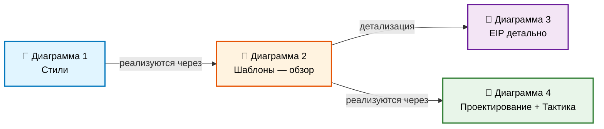

# Расширенная иерархия архитектурных концепций

```mermaid
graph TD
    Root[Архитектурные концепции]

    %% ============ УРОВЕНЬ 1: СТИЛИ ============
    Root --> Styles[Уровень 1: Архитектурные стили<br/>Architectural Styles]
    Styles --> S1[Монолит]
    Styles --> S2[Модульный монолит]
    Styles --> S3[Микросервисы]
    Styles --> S4[SOA]
    Styles --> S5[Event-Driven Architecture]
    Styles --> S6[Layered Architecture]
    Styles --> S7[Hexagonal Architecture]
    Styles --> S8[Onion Architecture]
    Styles --> S9[Clean Architecture]
    Styles --> S10[Serverless]
    Styles --> S11[Space-Based Architecture]
    Styles --> S12[Microkernel / Plugin]
    Styles --> S13[Pipe-and-Filter]
    Styles --> S14[Client-Server]
    Styles --> S15[Peer-to-Peer]
    Styles --> S16[CQRS-Style / Event-Sourced]
    Styles --> S17[Service-Oriented + Event-Driven<br/>Hybrid / EDA+MSA]
    Styles --> S18[Data Mesh]
    Styles --> S19[Lambda Architecture]
    Styles --> S20[Kappa Architecture]

    %% ============ УРОВЕНЬ 2: АРХИТЕКТУРНЫЕ ШАБЛОНЫ ============
    Root --> Patterns[Уровень 2: Архитектурные шаблоны<br/>Architectural Patterns]

    %% --- 2.1 Структурные ---
    Patterns --> Structural[Структурные]
    Structural --> ST1[API Gateway]
    Structural --> ST2[Backend for Frontend<br/>BFF]
    Structural --> ST3[Sidecar]
    Structural --> ST4[Ambassador]
    Structural --> ST5[Adapter]
    Structural --> ST6[Strangler Fig]
    Structural --> ST7[Anti-Corruption Layer]
    Structural --> ST8[Gateway Routing]
    Structural --> ST9[Gateway Aggregation]
    Structural --> ST10[Gateway Offloading]
    Structural --> ST11[Microservice Chassis]
    Structural --> ST12[Self-Contained Systems<br/>SCS]
    Structural --> ST13[Service Mesh]

    %% --- 2.2 Данные и консистентность ---
    Patterns --> DataPatterns[Данные и консистентность]
    DataPatterns --> DP1[Saga]
    DataPatterns --> DP2[CQRS]
    DataPatterns --> DP3[Event Sourcing]
    DataPatterns --> DP4[Database per Service]
    DataPatterns --> DP5[Shared Database Anti-Pattern]
    DataPatterns --> DP6[Two-Phase Commit<br/>2PC]
    DataPatterns --> DP7[Compensating Transactions]
    DataPatterns --> DP8[Idempotency]
    DataPatterns --> DP9[Outbox]
    DataPatterns --> DP10[Inbox]
    DataPatterns --> DP11[Transaction Log Tailing]
    DataPatterns --> DP12[Change Data Capture<br/>CDC]
    DataPatterns --> DP13[Materialized View]
    DataPatterns --> DP14[Claim Check]
    DataPatterns --> DP15[Sharding]
    DataPatterns --> DP16[Polyglot Persistence]
    DataPatterns --> DP17[Command Sourcing]

    %% --- 2.3 Интеграционные (EIP) ---
    Patterns --> EIP[Интеграционные<br/>Enterprise Integration Patterns]
    EIP --> EIP_Msg[Message Systems]
    EIP_Msg --> EM1[Message Channel]
    EIP_Msg --> EM2[Message]
    EIP_Msg --> EM3[Pipes and Filters]
    EIP_Msg --> EM4[Message Router]
    EIP_Msg --> EM5[Message Broker]
    EIP_Msg --> EM6[Message Bus]

    EIP --> EIP_Route[Message Routing]
    EIP_Route --> ER1[Content-Based Router]
    EIP_Route --> ER2[Message Filter]
    EIP_Route --> ER3[Recipient List]
    EIP_Route --> ER4[Splitter]
    EIP_Route --> ER5[Aggregator]
    EIP_Route --> ER6[Resequencer]
    EIP_Route --> ER7[Scatter-Gather]
    EIP_Route --> ER8[Routing Slip]
    EIP_Route --> ER9[Process Manager]
    EIP_Route --> ER10[Dynamic Router]
    EIP_Route --> ER11[Composed Message Processor]

    EIP --> EIP_Transform[Message Transformation]
    EIP_Transform --> ET1[Message Translator]
    EIP_Transform --> ET2[Content Enricher]
    EIP_Transform --> ET3[Content Filter]
    EIP_Transform --> ET4[Claim Check]
    EIP_Transform --> ET5[Normalizer]
    EIP_Transform --> ET6[Canonical Data Model]
    EIP_Transform --> ET7[Envelope Wrapper]

    EIP --> EIP_Endpoints[Messaging Endpoints]
    EIP_Endpoints --> EE1[Service Activator]
    EIP_Endpoints --> EE2[Messaging Gateway]
    EIP_Endpoints --> EE3[Transactional Client]
    EIP_Endpoints --> EE4[Polling Consumer]
    EIP_Endpoints --> EE5[Event-Driven Consumer]
    EIP_Endpoints --> EE6[Competing Consumers]
    EIP_Endpoints --> EE7[Message Dispatcher]
    EIP_Endpoints --> EE8[Selective Consumer]
    EIP_Endpoints --> EE9[Durable Subscriber]
    EIP_Endpoints --> EE10[Idempotent Receiver]

    EIP --> EIP_Manage[System Management]
    EIP_Manage --> EMg1[Wire Tap]
    EIP_Manage --> EMg2[Message History]
    EIP_Manage --> EMg3[Control Bus]
    EIP_Manage --> EMg4[Message Store]
    EIP_Manage --> EMg5[Smart Proxy]
    EIP_Manage --> EMg6[Test Message]
    EIP_Manage --> EMg7[Channel Purger]

    EIP --> EIP_Channels[Channel Patterns]
    EIP_Channels --> EC1[Point-to-Point Channel]
    EIP_Channels --> EC2[Publish-Subscribe Channel]
    EIP_Channels --> EC3[Datatype Channel]
    EIP_Channels --> EC4[Invalid Message Channel]
    EIP_Channels --> EC5[Dead Letter Channel]
    EIP_Channels --> EC6[Guaranteed Delivery]
    EIP_Channels --> EC7[Channel Adapter]
    EIP_Channels --> EC8[Messaging Bridge]
    EIP_Channels --> EC9[Message Bus]

    %% --- 2.4 Устойчивость и надёжность ---
    Patterns --> Resilience[Устойчивость и надёжность]
    Resilience --> R1[Circuit Breaker]
    Resilience --> R2[Retry]
    Resilience --> R3[Bulkhead]
    Resilience --> R4[Timeout]
    Resilience --> R5[Fallback]
    Resilience --> R6[Hedging]
    Resilience --> R7[Rate Limiting]
    Resilience --> R8[Throttling]
    Resilience --> R9[Load Shedding]
    Resilience --> R10[Health Endpoint Monitoring]
    Resilience --> R11[Leader Election]

    %% --- 2.5 Масштабирование ---
    Patterns --> Scalability[Масштабирование]
    Scalability --> Sc1[Horizontal Scaling]
    Scalability --> Sc2[Vertical Scaling]
    Scalability --> Sc3[Auto-scaling]
    Scalability --> Sc4[Partitioning]
    Scalability --> Sc5[Sharding]
    Scalability --> Sc6[Replication]
    Scalability --> Sc7[Caching<br/>Cache-Aside, Read-Through, Write-Behind]
    Scalability --> Sc8[CDN]
    Scalability --> Sc9[Queue-Based Load Leveling]
    Scalability --> Sc10[Priority Queue]

    %% --- 2.6 Безопасность ---
    Patterns --> Security[Безопасность]
    Security --> Sec1[API Gateway Auth]
    Security --> Sec2[Token Relay]
    Security --> Sec3[Federated Identity]
    Security --> Sec4[Valet Key]
    Security --> Sec5[mTLS]
    Security --> Sec6[Zero Trust]
    Security --> Sec7[Sidecar Authorization]

    %% --- 2.7 Наблюдаемость ---
    Patterns --> Observability[Наблюдаемость]
    Observability --> O1[Distributed Tracing]
    Observability --> O2[Correlation ID]
    Observability --> O3[Structured Logging]
    Observability --> O4[Metrics / RED / USE]
    Observability --> O5[Health Check API]
    Observability --> O6[Audit Logging]

    %% --- 2.8 Развёртывание ---
    Patterns --> Deployment[Развёртывание]
    Deployment --> D1[Blue-Green Deployment]
    Deployment --> D2[Canary Release]
    Deployment --> D3[Rolling Update]
    Deployment --> D4[Feature Toggle]
    Deployment --> D5[A/B Testing]
    Deployment --> D6[Shadow Deployment]
    Deployment --> D7[Immutable Infrastructure]
    Deployment --> D8[GitOps]

    %% --- 2.9 Управление потоком (из вашего файла) ---
    Patterns --> Flow[Управление потоком]
    Flow --> F1[Хореография<br/>Choreography]
    Flow --> F2[Оркестровка<br/>Orchestration]
    Flow --> F3[Workflow Engine]
    Flow --> F4[State Machine]

    %% ============ УРОВЕНЬ 3: ШАБЛОНЫ ПРОЕКТИРОВАНИЯ ============
    Root --> Design[Уровень 3: Шаблоны проектирования<br/>Design Patterns]

    Design --> GoF[GoF — Порождающие]
    GoF --> G1[Factory Method]
    GoF --> G2[Abstract Factory]
    GoF --> G3[Builder]
    GoF --> G4[Prototype]
    GoF --> G5[Singleton]

    Design --> GoF_S[GoF — Структурные]
    GoF_S --> G6[Adapter]
    GoF_S --> G7[Bridge]
    GoF_S --> G8[Composite]
    GoF_S --> G9[Decorator]
    GoF_S --> G10[Facade]
    GoF_S --> G11[Flyweight]
    GoF_S --> G12[Proxy]

    Design --> GoF_B[GoF — Поведенческие]
    GoF_B --> G13[Chain of Responsibility]
    GoF_B --> G14[Command]
    GoF_B --> G15[Iterator]
    GoF_B --> G16[Mediator]
    GoF_B --> G17[Memento]
    GoF_B --> G18[Observer]
    GoF_B --> G19[State]
    GoF_B --> G20[Strategy]
    GoF_B --> G21[Template Method]
    GoF_B --> G22[Visitor]

    Design --> PoEAA[PoEAA — Fowler]
    PoEAA --> P1[Repository]
    PoEAA --> P2[Unit of Work]
    PoEAA --> P3[Data Mapper]
    PoEAA --> P4[Active Record]
    PoEAA --> P5[Identity Map]
    PoEAA --> P6[Lazy Load]
    PoEAA --> P7[Domain Model]
    PoEAA --> P8[Service Layer]
    PoEAA --> P9[DTO]
    PoEAA --> P10[Gateway]
    PoEAA --> P11[Specification]
    PoEAA --> P12[Null Object]

    Design --> DDD[DDD — тактические]
    DDD --> DD1[Entity]
    DDD --> DD2[Value Object]
    DDD --> DD3[Aggregate]
    DDD --> DD4[Repository]
    DDD --> DD5[Domain Service]
    DDD --> DD6[Domain Event]
    DDD --> DD7[Factory]
    DDD --> DD8[Specification]

    %% ============ УРОВЕНЬ 4: ТАКТИЧЕСКИЕ ПАТТЕРНЫ / ИДИОМЫ ============
    Root --> Tactical[Уровень 4: Тактические паттерны / Идиомы]
    Tactical --> T1[Idempotency Key]
    Tactical --> T2[Optimistic Locking]
    Tactical --> T3[Pessimistic Locking]
    Tactical --> T4[Retry with Backoff]
    Tactical --> T5[Bulkhead Isolation]
    Tactical --> T6[Correlation ID Propagation]
    Tactical --> T7[Graceful Degradation]
    Tactical --> T8[Backpressure]
    Tactical --> T9[CQRS Projection]
    Tactical --> T10[Snapshot]
    Tactical --> T11[Anti-Corruption Layer]
    Tactical --> T12[Strangler Vine]

    %% ============ СТИЛИ (дополнительные связи) ============
    S3 -.->|реализуется через| Structural
    S3 -.->|реализуется через| DataPatterns
    S3 -.->|реализуется через| Resilience
    S5 -.->|использует| EIP
    S4 -.->|использует| EIP
    S16 -.->|использует| DP2
    S16 -.->|использует| DP3
    S18 -.->|использует| DP16
    S19 -.->|использует| EIP
    S20 -.->|использует| EIP

    %% ============ СВЯЗИ МЕЖДУ УРОВНЯМИ ============
    Patterns -.->|реализуются через| Design
    EIP -.->|реализуются через| Design
    EIP -.->|уточняются в| Tactical
    DataPatterns -.->|используют| Tactical
    Resilience -.->|используют| Tactical

    %% ============ СТИЛИЗАЦИЯ ============
    classDef styles fill:#e1f5ff,stroke:#0277bd,stroke-width:2px
    classDef patterns fill:#fff3e0,stroke:#e65100,stroke-width:2px
    classDef design fill:#e8f5e9,stroke:#2e7d32,stroke-width:2px
    classDef tactical fill:#fce4ec,stroke:#ad1457,stroke-width:2px
    classDef eip fill:#f3e5f5,stroke:#6a1b9a,stroke-width:2px

    class S1,S2,S3,S4,S5,S6,S7,S8,S9,S10,S11,S12,S13,S14,S15,S16,S17,S18,S19,S20 styles
    class ST1,ST2,ST3,ST4,ST5,ST6,ST7,ST8,ST9,ST10,ST11,ST12,ST13,DP1,DP2,DP3,DP4,DP5,DP6,DP7,DP8,DP9,DP10,DP11,DP12,DP13,DP14,DP15,DP16,DP17,R1,R2,R3,R4,R5,R6,R7,R8,R9,R10,R11,Sc1,Sc2,Sc3,Sc4,Sc5,Sc6,Sc7,Sc8,Sc9,Sc10,Sec1,Sec2,Sec3,Sec4,Sec5,Sec6,Sec7,O1,O2,O3,O4,O5,O6,D1,D2,D3,D4,D5,D6,D7,D8,F1,F2,F3,F4 patterns
    class EM1,EM2,EM3,EM4,EM5,EM6,ER1,ER2,ER3,ER4,ER5,ER6,ER7,ER8,ER9,ER10,ER11,ET1,ET2,ET3,ET4,ET5,ET6,ET7,EE1,EE2,EE3,EE4,EE5,EE6,EE7,EE8,EE9,EE10,EMg1,EMg2,EMg3,EMg4,EMg5,EMg6,EMg7,EC1,EC2,EC3,EC4,EC5,EC6,EC7,EC8,EC9 eip
    class G1,G2,G3,G4,G5,G6,G7,G8,G9,G10,G11,G12,G13,G14,G15,G16,G17,G18,G19,G20,G21,G22,P1,P2,P3,P4,P5,P6,P7,P8,P9,P10,P11,P12,DD1,DD2,DD3,DD4,DD5,DD6,DD7,DD8 design
    class T1,T2,T3,T4,T5,T6,T7,T8,T9,T10,T11,T12 tactical
```

## Пояснения к иерархии

### Уровень 1: Архитектурные стили
Определяют **фундаментальную структуру** всей системы: как она организована на верхнем уровне, какие принципы взаимодействия и развёртывания применяются. Стиль выбирается один (или гибрид) на систему.

### Уровень 2: Архитектурные шаблоны
Решают **конкретные структурные задачи** внутри выбранного стиля. Можно комбинировать несколько паттернов одновременно. Здесь же находятся **EIP** — интеграционные архитектурные шаблоны.

### Уровень 3: Шаблоны проектирования
Работают на уровне **классов и объектов** внутри компонентов. Классика GoF, PoEAA Фаулера, тактические паттерны DDD.

### Уровень 4: Тактические паттерны / идиомы
Мелкие приёмы, часто привязанные к конкретным технологиям или сценариям. Могут не иметь канонического названия в литературе.

## Ключевые связи между уровнями

- **Стиль → Паттерны**: Микросервисы *реализуются через* API Gateway, Saga, Database per Service, Circuit Breaker.
- **Паттерны → Проектирование**: API Gateway *реализуется через* Facade + Proxy + Strategy.
- **EIP → Проектирование**: Content-Based Router *реализуется через* Strategy + Chain of Responsibility.
- **Паттерны → Тактика**: Saga *использует* Idempotency Key, Compensating Transactions, Outbox.

## Важное замечание

Границы между уровнями **условны и контекстны**. Например:

- **CQRS** может быть и архитектурным стилем (для всей системы), и паттерном (для одного сервиса).
- **Saga** в одних источниках — архитектурный паттерн, в других — тактический.
- **Outbox** — пограничный случай между паттерном и тактикой.

Эта иерархия — **инструмент коммуникации**, а не догма. Главное — чтобы команда понимала, о каком уровне абстракции идёт речь в каждом конкретном обсуждении.

# Иерархия архитектурных концепций — читаемая схема

## Как читать эту схему

**Направление потока**: слева направо — от высокоуровневых концепций к низкоуровневым.

**Четыре колонки-уровня**:
1. 🎯 **Стили** (голубой) — выбираются один раз для системы.
2. 🏗️ **Архитектурные шаблоны** (оранжевый) — комбинируются внутри стиля.
3. ⚙️ **Шаблоны проектирования** (зелёный) — работают на уровне классов.
4. 🎯 **Тактические паттерны** (розовый) — мелкие приёмы.

**Группировка внутри Уровня 2**:
- 📦 Структурные — как организованы компоненты.
- 💾 Данные — как обеспечить консистентность.
- 🔗 EIP — как передаются сообщения (внутри — 6 подгрупп).
- 🛡️ Устойчивость — как переживать сбои.
- 📈 Масштабирование — как расти.
- 🔐 Безопасность — как защищаться.
- 👁️ Наблюдаемость — как видеть, что происходит.
- 🚀 Развёртывание — как выпускать изменения.
- 🔄 Управление потоком — как координировать процессы.

# Иерархия архитектурных концепций — 4 отдельные диаграммы

## 📘 Диаграмма 1: Архитектурные стили (Уровень 1)

```mermaid
graph TD
    Root[🎯 УРОВЕНЬ 1:<br/>АРХИТЕКТУРНЫЕ СТИЛИ]

    Root --> Classic[Классические]
    Classic --> S1[Монолит]
    Classic --> S2[Модульный монолит]
    Classic --> S6[Layered Architecture]
    Classic --> S14[Client-Server]
    Classic --> S15[Peer-to-Peer]
    Classic --> S13[Pipe-and-Filter]

    Root --> Distributed[Распределённые]
    Distributed --> S3[Микросервисы]
    Distributed --> S4[SOA]
    Distributed --> S17[EDA + MSA Hybrid]
    Distributed --> S18[Data Mesh]
    Distributed --> S12[Microkernel]
    Distributed --> S11[Space-Based]

    Root --> EventDriven[Событийно-ориентированные]
    EventDriven --> S5[Event-Driven<br/>Architecture]
    EventDriven --> S16[CQRS-Style /<br/>Event-Sourced]
    EventDriven --> S19[Lambda<br/>Architecture]
    EventDriven --> S20[Kappa<br/>Architecture]

    Root --> Clean[Чистые / Луковичные]
    Clean --> S7[Hexagonal]
    Clean --> S8[Onion]
    Clean --> S9[Clean]

    Root --> Cloud[Облачные]
    Cloud --> S10[Serverless]

    classDef styles fill:#e1f5ff,stroke:#0277bd,stroke-width:2px,color:#000
    classDef groups fill:#b3e5fc,stroke:#01579b,stroke-width:2px,color:#000
    classDef root fill:#0277bd,stroke:#01579b,stroke-width:3px,color:#fff

    class S1,S2,S3,S4,S5,S6,S7,S8,S9,S10,S11,S12,S13,S14,S15,S16,S17,S18,S19,S20 styles
    class Classic,Distributed,EventDriven,Clean,Cloud groups
    class Root root
```

---

## 📙 Диаграмма 2: Архитектурные шаблоны — обзор (Уровень 2)

```mermaid
graph TD
    Root[🏗️ УРОВЕНЬ 2:<br/>АРХИТЕКТУРНЫЕ ШАБЛОНЫ]

    Root --> P_STRUCT[📦 Структурные]
    Root --> P_DATA[💾 Данные и консистентность]
    Root --> P_EIP[🔗 Интеграционные EIP]
    Root --> P_RES[🛡️ Устойчивость]
    Root --> P_SCALE[📈 Масштабирование]
    Root --> P_SEC[🔐 Безопасность]
    Root --> P_OBS[👁️ Наблюдаемость]
    Root --> P_DEP[🚀 Развёртывание]
    Root --> P_FLOW[🔄 Управление потоком]

    P_STRUCT --> ST1[API Gateway]
    P_STRUCT --> ST2[BFF]
    P_STRUCT --> ST3[Sidecar]
    P_STRUCT --> ST4[Ambassador]
    P_STRUCT --> ST5[Adapter]
    P_STRUCT --> ST6[Strangler Fig]
    P_STRUCT --> ST7[Anti-Corruption Layer]
    P_STRUCT --> ST8[Gateway Routing]
    P_STRUCT --> ST9[Gateway Aggregation]
    P_STRUCT --> ST10[Gateway Offloading]
    P_STRUCT --> ST11[Microservice Chassis]
    P_STRUCT --> ST12[SCS]
    P_STRUCT --> ST13[Service Mesh]

    P_DATA --> DP1[Saga]
    P_DATA --> DP2[CQRS]
    P_DATA --> DP3[Event Sourcing]
    P_DATA --> DP4[Database per Service]
    P_DATA --> DP5[Shared Database<br/>Anti-Pattern]
    P_DATA --> DP6[2PC]
    P_DATA --> DP7[Compensating<br/>Transactions]
    P_DATA --> DP8[Idempotency]
    P_DATA --> DP9[Outbox]
    P_DATA --> DP10[Inbox]
    P_DATA --> DP11[Transaction Log<br/>Tailing]
    P_DATA --> DP12[CDC]
    P_DATA --> DP13[Materialized View]
    P_DATA --> DP14[Claim Check]
    P_DATA --> DP15[Sharding]
    P_DATA --> DP16[Polyglot<br/>Persistence]
    P_DATA --> DP17[Command Sourcing]

    P_EIP --> EIP_MSG[Message Systems]
    P_EIP --> EIP_ROUTE[Message Routing]
    P_EIP --> EIP_TRANS[Message Transformation]
    P_EIP --> EIP_END[Messaging Endpoints]
    P_EIP --> EIP_MAN[System Management]
    P_EIP --> EIP_CHAN[Channel Patterns]
    P_EIP --> EIP_DETAILS[→ см. Диаграмму 3]

    P_RES --> R1[Circuit Breaker]
    P_RES --> R2[Retry]
    P_RES --> R3[Bulkhead]
    P_RES --> R4[Timeout]
    P_RES --> R5[Fallback]
    P_RES --> R6[Hedging]
    P_RES --> R7[Rate Limiting]
    P_RES --> R8[Throttling]
    P_RES --> R9[Load Shedding]
    P_RES --> R10[Health Endpoint<br/>Monitoring]
    P_RES --> R11[Leader Election]

    P_SCALE --> Sc1[Horizontal Scaling]
    P_SCALE --> Sc2[Vertical Scaling]
    P_SCALE --> Sc3[Auto-scaling]
    P_SCALE --> Sc4[Partitioning]
    P_SCALE --> Sc5[Sharding]
    P_SCALE --> Sc6[Replication]
    P_SCALE --> Sc7[Caching]
    P_SCALE --> Sc8[CDN]
    P_SCALE --> Sc9[Queue-Based Load<br/>Leveling]
    P_SCALE --> Sc10[Priority Queue]

    P_SEC --> Sec1[API Gateway Auth]
    P_SEC --> Sec2[Token Relay]
    P_SEC --> Sec3[Federated Identity]
    P_SEC --> Sec4[Valet Key]
    P_SEC --> Sec5[mTLS]
    P_SEC --> Sec6[Zero Trust]
    P_SEC --> Sec7[Sidecar Authorization]

    P_OBS --> O1[Distributed Tracing]
    P_OBS --> O2[Correlation ID]
    P_OBS --> O3[Structured Logging]
    P_OBS --> O4[Metrics / RED / USE]
    P_OBS --> O5[Health Check API]
    P_OBS --> O6[Audit Logging]

    P_DEP --> D1[Blue-Green]
    P_DEP --> D2[Canary Release]
    P_DEP --> D3[Rolling Update]
    P_DEP --> D4[Feature Toggle]
    P_DEP --> D5[A/B Testing]
    P_DEP --> D6[Shadow Deployment]
    P_DEP --> D7[Immutable Infrastructure]
    P_DEP --> D8[GitOps]

    P_FLOW --> F1[Хореография]
    P_FLOW --> F2[Оркестровка]
    P_FLOW --> F3[Workflow Engine]
    P_FLOW --> F4[State Machine]

    classDef patterns fill:#fff3e0,stroke:#e65100,stroke-width:2px,color:#000
    classDef groups fill:#ffcc80,stroke:#e65100,stroke-width:2px,color:#000
    classDef root fill:#e65100,stroke:#bf360c,stroke-width:3px,color:#fff
    classDef eipGroup fill:#f3e5f5,stroke:#6a1b9a,stroke-width:2px,color:#000

    class ST1,ST2,ST3,ST4,ST5,ST6,ST7,ST8,ST9,ST10,ST11,ST12,ST13,DP1,DP2,DP3,DP4,DP5,DP6,DP7,DP8,DP9,DP10,DP11,DP12,DP13,DP14,DP15,DP16,DP17,R1,R2,R3,R4,R5,R6,R7,R8,R9,R10,R11,Sc1,Sc2,Sc3,Sc4,Sc5,Sc6,Sc7,Sc8,Sc9,Sc10,Sec1,Sec2,Sec3,Sec4,Sec5,Sec6,Sec7,O1,O2,O3,O4,O5,O6,D1,D2,D3,D4,D5,D6,D7,D8,F1,F2,F3,F4 patterns
    class P_STRUCT,P_DATA,P_RES,P_SCALE,P_SEC,P_OBS,P_DEP,P_FLOW groups
    class P_EIP,EIP_MSG,EIP_ROUTE,EIP_TRANS,EIP_END,EIP_MAN,EIP_CHAN,EIP_DETAILS eipGroup
    class Root root
```

---

## 📗 Диаграмма 3: EIP детально (внутри Уровня 2)

```mermaid
graph TD
    Root[🔗 ИНТЕГРАЦИОННЫЕ ШАБЛОНЫ<br/>Enterprise Integration Patterns]

    Root --> EIP_MSG[📨 Message Systems]
    EIP_MSG --> EM1[Message Channel]
    EIP_MSG --> EM2[Message]
    EIP_MSG --> EM3[Pipes and Filters]
    EIP_MSG --> EM4[Message Router]
    EIP_MSG --> EM5[Message Broker]
    EIP_MSG --> EM6[Message Bus]

    Root --> EIP_ROUTE[🔀 Message Routing]
    EIP_ROUTE --> ER1[Content-Based Router]
    EIP_ROUTE --> ER2[Message Filter]
    EIP_ROUTE --> ER3[Recipient List]
    EIP_ROUTE --> ER4[Splitter]
    EIP_ROUTE --> ER5[Aggregator]
    EIP_ROUTE --> ER6[Resequencer]
    EIP_ROUTE --> ER7[Scatter-Gather]
    EIP_ROUTE --> ER8[Routing Slip]
    EIP_ROUTE --> ER9[Process Manager]
    EIP_ROUTE --> ER10[Dynamic Router]
    EIP_ROUTE --> ER11[Composed Message<br/>Processor]

    Root --> EIP_TRANS[🔄 Message Transformation]
    EIP_TRANS --> ET1[Message Translator]
    EIP_TRANS --> ET2[Content Enricher]
    EIP_TRANS --> ET3[Content Filter]
    EIP_TRANS --> ET4[Claim Check]
    EIP_TRANS --> ET5[Normalizer]
    EIP_TRANS --> ET6[Canonical Data Model]
    EIP_TRANS --> ET7[Envelope Wrapper]

    Root --> EIP_END[🎯 Messaging Endpoints]
    EIP_END --> EE1[Service Activator]
    EIP_END --> EE2[Messaging Gateway]
    EIP_END --> EE3[Transactional Client]
    EIP_END --> EE4[Polling Consumer]
    EIP_END --> EE5[Event-Driven Consumer]
    EIP_END --> EE6[Competing Consumers]
    EIP_END --> EE7[Message Dispatcher]
    EIP_END --> EE8[Selective Consumer]
    EIP_END --> EE9[Durable Subscriber]
    EIP_END --> EE10[Idempotent Receiver]

    Root --> EIP_MAN[🛠️ System Management]
    EIP_MAN --> EMg1[Wire Tap]
    EIP_MAN --> EMg2[Message History]
    EIP_MAN --> EMg3[Control Bus]
    EIP_MAN --> EMg4[Message Store]
    EIP_MAN --> EMg5[Smart Proxy]
    EIP_MAN --> EMg6[Test Message]
    EIP_MAN --> EMg7[Channel Purger]

    Root --> EIP_CHAN[📡 Channel Patterns]
    EIP_CHAN --> EC1[Point-to-Point Channel]
    EIP_CHAN --> EC2[Publish-Subscribe<br/>Channel]
    EIP_CHAN --> EC3[Datatype Channel]
    EIP_CHAN --> EC4[Invalid Message Channel]
    EIP_CHAN --> EC5[Dead Letter Channel]
    EIP_CHAN --> EC6[Guaranteed Delivery]
    EIP_CHAN --> EC7[Channel Adapter]
    EIP_CHAN --> EC8[Messaging Bridge]
    EIP_CHAN --> EC9[Message Bus]

    classDef eip fill:#f3e5f5,stroke:#6a1b9a,stroke-width:2px,color:#000
    classDef groups fill:#e1bee7,stroke:#6a1b9a,stroke-width:2px,color:#000
    classDef root fill:#6a1b9a,stroke:#4a148c,stroke-width:3px,color:#fff

    class EM1,EM2,EM3,EM4,EM5,EM6,ER1,ER2,ER3,ER4,ER5,ER6,ER7,ER8,ER9,ER10,ER11,ET1,ET2,ET3,ET4,ET5,ET6,ET7,EE1,EE2,EE3,EE4,EE5,EE6,EE7,EE8,EE9,EE10,EMg1,EMg2,EMg3,EMg4,EMg5,EMg6,EMg7,EC1,EC2,EC3,EC4,EC5,EC6,EC7,EC8,EC9 eip
    class EIP_MSG,EIP_ROUTE,EIP_TRANS,EIP_END,EIP_MAN,EIP_CHAN groups
    class Root root
```

---

## 📕 Диаграмма 4: Шаблоны проектирования и тактические (Уровни 3–4)

```mermaid
graph TD
    Root3[⚙️ УРОВЕНЬ 3:<br/>ШАБЛОНЫ ПРОЕКТИРОВАНИЯ]

    Root3 --> GoF_C[GoF — Порождающие]
    GoF_C --> G1[Factory Method]
    GoF_C --> G2[Abstract Factory]
    GoF_C --> G3[Builder]
    GoF_C --> G4[Prototype]
    GoF_C --> G5[Singleton]

    Root3 --> GoF_S[GoF — Структурные]
    GoF_S --> G6[Adapter]
    GoF_S --> G7[Bridge]
    GoF_S --> G8[Composite]
    GoF_S --> G9[Decorator]
    GoF_S --> G10[Facade]
    GoF_S --> G11[Flyweight]
    GoF_S --> G12[Proxy]

    Root3 --> GoF_B[GoF — Поведенческие]
    GoF_B --> G13[Chain of Responsibility]
    GoF_B --> G14[Command]
    GoF_B --> G15[Iterator]
    GoF_B --> G16[Mediator]
    GoF_B --> G17[Memento]
    GoF_B --> G18[Observer]
    GoF_B --> G19[State]
    GoF_B --> G20[Strategy]
    GoF_B --> G21[Template Method]
    GoF_B --> G22[Visitor]

    Root3 --> PoEAA[PoEAA — Fowler]
    PoEAA --> P1[Repository]
    PoEAA --> P2[Unit of Work]
    PoEAA --> P3[Data Mapper]
    PoEAA --> P4[Active Record]
    PoEAA --> P5[Identity Map]
    PoEAA --> P6[Lazy Load]
    PoEAA --> P7[Domain Model]
    PoEAA --> P8[Service Layer]
    PoEAA --> P9[DTO]
    PoEAA --> P10[Gateway]
    PoEAA --> P11[Specification]
    PoEAA --> P12[Null Object]

    Root3 --> DDD_T[DDD — тактические]
    DDD_T --> DD1[Entity]
    DDD_T --> DD2[Value Object]
    DDD_T --> DD3[Aggregate]
    DDD_T --> DD4[Repository]
    DDD_T --> DD5[Domain Service]
    DDD_T --> DD6[Domain Event]
    DDD_T --> DD7[Factory]
    DDD_T --> DD8[Specification]

    Root4[🎯 УРОВЕНЬ 4:<br/>ТАКТИЧЕСКИЕ ПАТТЕРНЫ / ИДИОМЫ]
    Root4 --> T1[Idempotency Key]
    Root4 --> T2[Optimistic Locking]
    Root4 --> T3[Pessimistic Locking]
    Root4 --> T4[Retry with Backoff]
    Root4 --> T5[Bulkhead Isolation]
    Root4 --> T6[Correlation ID<br/>Propagation]
    Root4 --> T7[Graceful Degradation]
    Root4 --> T8[Backpressure]
    Root4 --> T9[CQRS Projection]
    Root4 --> T10[Snapshot]
    Root4 --> T11[Anti-Corruption Layer]
    Root4 --> T12[Strangler Vine]

    Root3 -.->|уточняются в| Root4

    classDef design fill:#e8f5e9,stroke:#2e7d32,stroke-width:2px,color:#000
    classDef tactical fill:#fce4ec,stroke:#ad1457,stroke-width:2px,color:#000
    classDef groupsG fill:#c8e6c9,stroke:#2e7d32,stroke-width:2px,color:#000
    classDef groupsT fill:#f8bbd0,stroke:#ad1457,stroke-width:2px,color:#000
    classDef root3 fill:#2e7d32,stroke:#1b5e20,stroke-width:3px,color:#fff
    classDef root4 fill:#ad1457,stroke:#880e4f,stroke-width:3px,color:#fff

    class G1,G2,G3,G4,G5,G6,G7,G8,G9,G10,G11,G12,G13,G14,G15,G16,G17,G18,G19,G20,G21,G22,P1,P2,P3,P4,P5,P6,P7,P8,P9,P10,P11,P12,DD1,DD2,DD3,DD4,DD5,DD6,DD7,DD8 design
    class T1,T2,T3,T4,T5,T6,T7,T8,T9,T10,T11,T12 tactical
    class GoF_C,GoF_S,GoF_B,PoEAA,DDD_T groupsG
    class Root3 root3
    class Root4 root4
```

---

## 🗺️ Навигация между диаграммами

## Как пользоваться

- **Диаграмма 1** — выберите стиль для всей системы.
- **Диаграмма 2** — подберите комбинацию архитектурных шаблонов внутри выбранного стиля.
- **Диаграмма 3** — углубитесь в EIP, если нужна детальная интеграция.
- **Диаграмма 4** — перейдите на уровень классов и тактических приёмов для реализации.

Каждая диаграмма **помещается на один экран** и читается сверху вниз или слева направо без горизонтального скролла.