# **Интеграционные шаблоны (Enterprise Integration Patterns)**

## Оглавление
- [**Описание**](#описание)
- [**Основные категории шаблонов**](#основные-категории-шаблонов)
  - [**1. Messaging Systems (Системы обмена сообщениями)**](#1-messaging-systems-системы-обмена-сообщениями)
    - [**1.1. Message Channel**](#11-message-channel)
    - [**1.2. Message**](#12-message)
    - [**1.3. Pipes and Filters**](#13-pipes-and-filters)
    - [**1.4. Message Router**](#14-message-router)
  - [**2. Message Routing (Маршрутизация сообщений)**](#2-message-routing-маршрутизация-сообщений)
    - [**2.1. Content-Based Router**](#21-content-based-router)
    - [**2.2. Message Filter**](#22-message-filter)
    - [**2.3. Recipient List**](#23-recipient-list)
    - [**2.4. Splitter**](#24-splitter)
    - [**2.5. Aggregator**](#25-aggregator)
    - [**2.6. Resequencer**](#26-resequencer)
    - [**2.7. Scatter-Gather**](#27-scatter-gather)
    - [**2.8. Routing Slip**](#28-routing-slip)
  - [**3. Message Transformation (Трансформация сообщений)**](#3-message-transformation-трансформация-сообщений)
    - [**3.1. Message Translator**](#31-message-translator)
    - [**3.2. Content Enricher**](#32-content-enricher)
    - [**3.3. Content Filter**](#33-content-filter)
    - [**3.4. Claim Check**](#34-claim-check)
    - [**3.5. Normalizer**](#35-normalizer)
  - [**4. Messaging Endpoints (Конечные точки)**](#4-messaging-endpoints-конечные-точки)
    - [**4.1. Service Activator**](#41-service-activator)
    - [**4.2. Messaging Gateway**](#42-messaging-gateway)
    - [**4.3. Transactional Client**](#43-transactional-client)
  - [**5. System Management (Управление системой)**](#5-system-management-управление-системой)
    - [**5.1. Wire Tap**](#51-wire-tap)
    - [**5.2. Message History**](#52-message-history)
    - [**5.3. Control Bus**](#53-control-bus)
- [**Пример реализации на C# (Apache Camel / MassTransit)**](#пример-реализации-на-c-apache-camel--masstransit)
  - [**1. Content-Based Router (MassTransit)**](#1-content-based-router-masstransit)
  - [**2. Splitter и Aggregator**](#2-splitter-и-aggregator)
  - [**3. Message Filter**](#3-message-filter)
- [**Сравнение подходов**](#сравнение-подходов)
- [**Рекомендации по выбору**](#рекомендации-по-выбору)
- [**Когда использовать интеграционные шаблоны?**](#когда-использовать-интеграционные-шаблоны)


## **Описание**
Интеграционные шаблоны (Enterprise Integration Patterns, EIP) — это набор проверенных решений для проектирования распределённых систем и интеграции приложений. Они описывают, как соединять разнородные системы через **асинхронный обмен сообщениями**, обеспечивая слабую связанность (loose coupling) и надёжность . 

Шаблоны не привязаны к конкретной технологии и применимы как к JMS, MSMQ, WCF, так и к современным брокерам: Kafka, RabbitMQ, Azure Service Bus . Они формируют общий язык для архитекторов и разработчиков, позволяя описывать интеграционные решения независимо от инструментов.

---

## **Основные категории шаблонов**

---

### **1. Messaging Systems (Системы обмена сообщениями)**

#### **1.1. Message Channel**
**Описание**: Канал — это логический «трубопровод», по которому сообщения передаются от отправителя к получателю. Канал абстрагирует физический транспорт (очередь, топик) и обеспечивает временную и пространственную развязку .

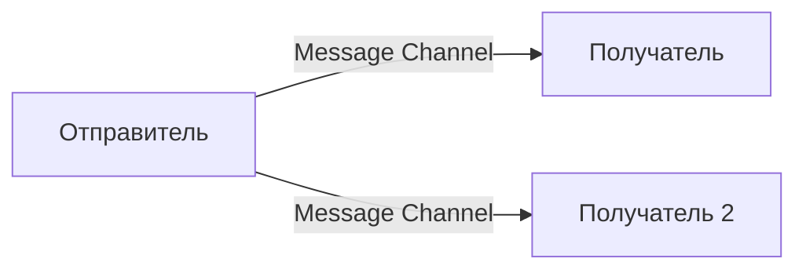

**Типы каналов**:
- **Point-to-Point**: одно сообщение — один получатель.
- **Publish-Subscribe**: одно сообщение — множество подписчиков.

**Преимущества**: Слабая связанность, буферизация, асинхронность.

---

#### **1.2. Message**
**Описание**: Сообщение — это пакет данных, передаваемый по каналу. Оно состоит из **заголовка** (метаданные: ID, timestamp, correlation ID) и **тела** (payload) .

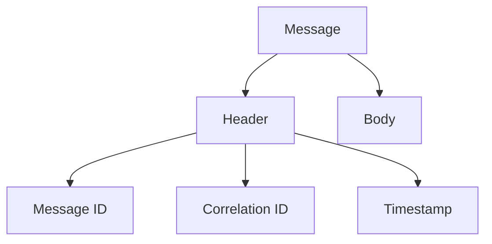

**Преимущества**: Единый формат для всех интеграций, возможность добавления метаданных без изменения payload.

---

#### **1.3. Pipes and Filters**
**Описание**: Обработка сообщения разбивается на последовательность независимых шагов (фильтров), соединённых каналами (pipes). Каждый фильтр выполняет одну операцию и передаёт результат дальше .

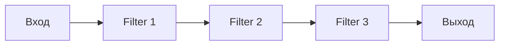

**Преимущества**: Модульность, возможность повторного использования фильтров, простота тестирования.

**Пример**: Цепочка обработки заказа: валидация → обогащение данными → сохранение → уведомление.

---

#### **1.4. Message Router**
**Описание**: Компонент, который принимает сообщение и определяет, в какой канал его направить. Роутер не изменяет сообщение, а только принимает решение о маршруте .

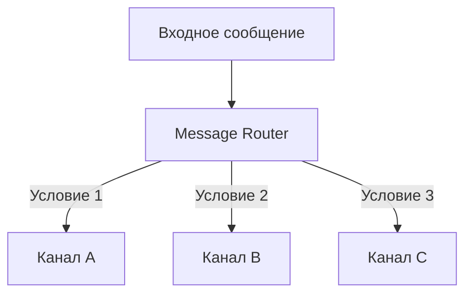

**Преимущества**: Централизация логики маршрутизации, развязка отправителя и получателя.

---

### **2. Message Routing (Маршрутизация сообщений)**

#### **2.1. Content-Based Router**
**Описание**: Роутер, который анализирует **содержимое** сообщения (payload или заголовки) и направляет его в соответствующий канал на основе правил .

```mermaid
graph TD
    A[Заказ] --> B[Content-Based Router]
    B -->|Тип = "Книга"| C[Склад книг]
    B -->|Тип = "Электроника"| D[Склад электроники]
    B -->|Тип = "Одежда"| E[Склад одежды]
```

**Преимущества**: Гибкость, возможность добавления новых маршрутов без изменения отправителя.

**Пример**: Маршрутизация заказов в зависимости от категории товара.

---

#### **2.2. Message Filter**
**Описание**: Компонент, который пропускает только сообщения, соответствующие определённому условию, и отбрасывает остальные .

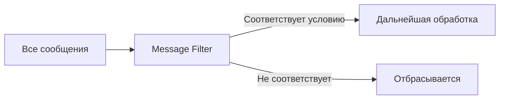

**Преимущества**: Снижение нагрузки на downstream-системы, изоляция нерелевантных данных.

**Пример**: Пропускать только заказы с суммой > 10 000 руб. для ручной проверки.

---

#### **2.3. Recipient List**
**Описание**: Роутер, который направляет сообщение **списку получателей**, определённому статически или динамически .

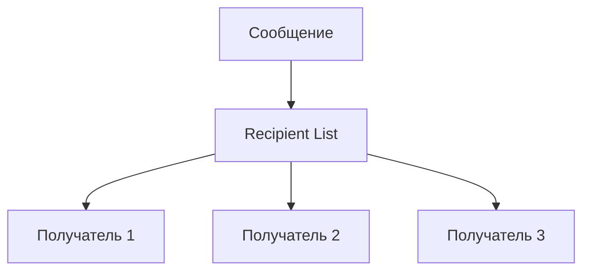

**Преимущества**: Широковещательная рассылка, возможность динамического определения получателей.

**Пример**: Уведомление о новом заказе отправляется в CRM, на склад и в систему аналитики.

---

#### **2.4. Splitter**
**Описание**: Разбивает одно сообщение на несколько сообщений, каждое из которых обрабатывается независимо .

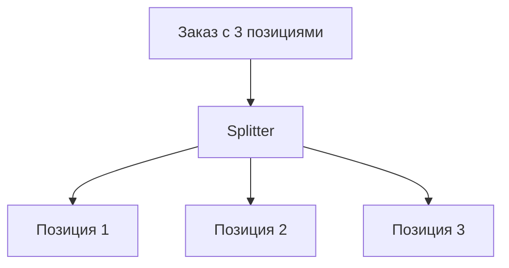

**Преимущества**: Параллельная обработка, возможность независимой обработки каждой части.

**Пример**: Заказ с несколькими товарами разбивается на отдельные позиции для параллельной обработки.

---

#### **2.5. Aggregator**
**Описание**: Собирает несколько связанных сообщений в одно. Часто используется вместе со Splitter для обратной сборки результатов .

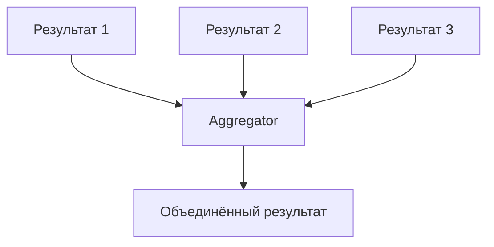

**Преимущества**: Возможность обработки составных операций, сборка ответов от нескольких сервисов.

**Пример**: Сборка результатов проверки наличия товаров на нескольких складах.

---

#### **2.6. Resequencer**
**Описание**: Восстанавливает правильный порядок сообщений, которые пришли в неправильной последовательности .

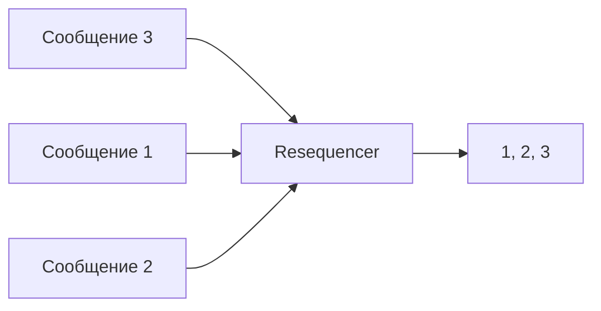

**Преимущества**: Гарантия порядка обработки, критично для финансовых операций.

**Пример**: Восстановление порядка транзакций при асинхронной обработке.

---

#### **2.7. Scatter-Gather**
**Описание**: Отправляет сообщение нескольким получателям и собирает ответы от всех. Комбинация Recipient List и Aggregator .

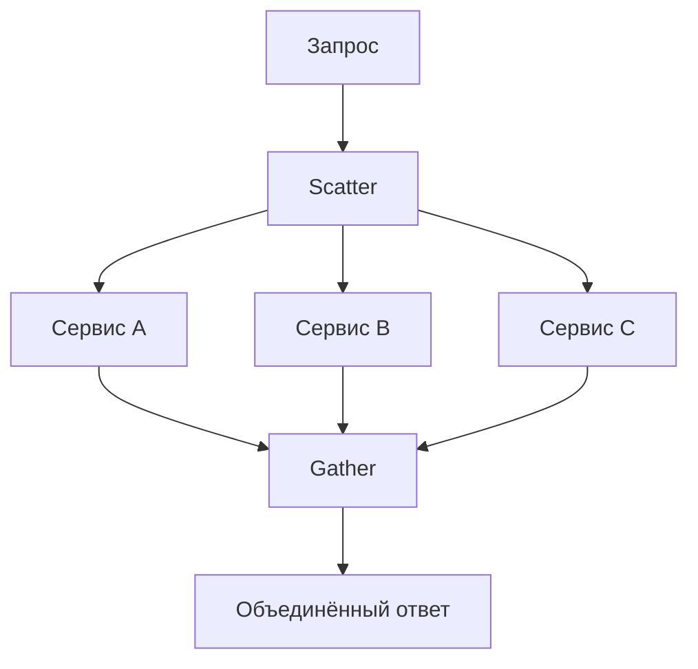

**Преимущества**: Параллельный опрос, агрегация результатов.

**Пример**: Проверка цены товара у нескольких поставщиков и выбор лучшей.

---

#### **2.8. Routing Slip**
**Описание**: Сообщение содержит список шагов (routing slip), которые оно должно пройти. На каждом шаге компонент удаляет текущий шаг и передаёт сообщение дальше .

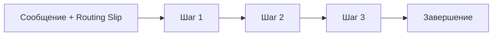

**Преимущества**: Динамическое определение маршрута, возможность изменения последовательности без изменения кода.

**Пример**: Обработка заказа с динамически определяемой цепочкой шагов (проверка → оплата → доставка).

---

### **3. Message Transformation (Трансформация сообщений)**

#### **3.1. Message Translator**
**Описание**: Преобразует сообщение из одного формата в другой (например, JSON → XML, или в каноническую модель данных) .

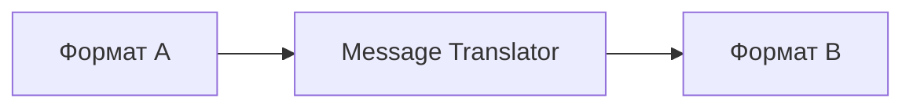

**Преимущества**: Возможность интеграции систем с разными форматами данных.

**Пример**: Преобразование заказа из формата CRM в формат ERP.

---

#### **3.2. Content Enricher**
**Описание**: Добавляет в сообщение данные из внешнего источника (например, из базы данных или API) .

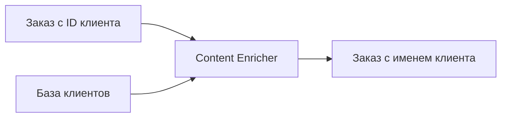

**Преимущества**: Обогащение данных без изменения исходного сообщения.

**Пример**: Добавление информации о клиенте в заказ по его ID.

---

#### **3.3. Content Filter**
**Описание**: Удаляет из сообщения ненужные данные, оставляя только необходимые .

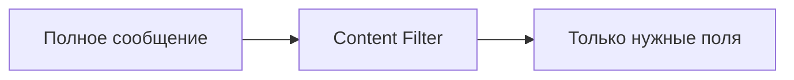

**Преимущества**: Уменьшение размера сообщения, сокрытие конфиденциальных данных.

**Пример**: Удаление персональных данных клиента перед отправкой в аналитику.

---

#### **3.4. Claim Check**
**Описание**: Заменяет большой payload на ссылку (claim check), а сами данные хранятся отдельно. Позволяет передавать большие данные через системы с ограничениями на размер сообщения .


**Преимущества**: Обход ограничений на размер сообщения, эффективное использование пропускной способности.

**Пример**: Передача больших файлов через систему обмена сообщениями.

---

#### **3.5. Normalizer**
**Описание**: Преобразует сообщения из разных форматов в **единый канонический формат** для дальнейшей обработки .

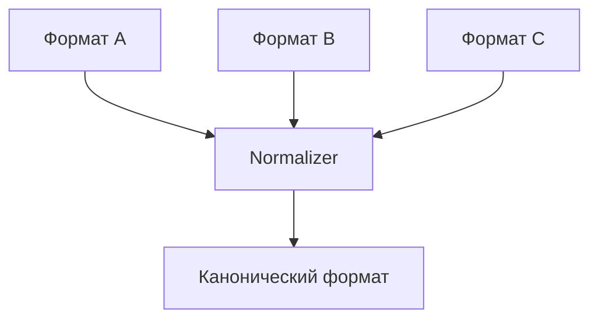

**Преимущества**: Унификация обработки, упрощение логики downstream-систем.

**Пример**: Приведение заказов из разных источников (сайт, мобильное приложение, API) к единому формату.

---

### **4. Messaging Endpoints (Конечные точки)**

#### **4.1. Service Activator**
**Описание**: Компонент, который принимает сообщение из канала и вызывает соответствующий сервис (метод) .

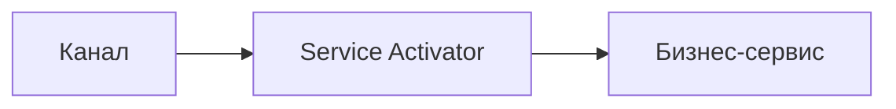

**Преимущества**: Развязка транспорта и бизнес-логики, возможность повторного использования сервисов.

**Пример**: Активация метода обработки заказа при получении сообщения из очереди.

---

#### **4.2. Messaging Gateway**
**Описание**: Инкапсулирует доступ к системе обмена сообщениями, предоставляя простой API для отправки и получения сообщений .

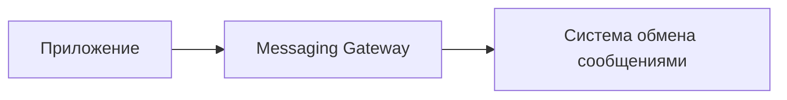

**Преимущества**: Сокрытие сложности messaging API, упрощение тестирования.

**Пример**: Обёртка над Kafka Producer/Consumer для отправки и получения сообщений.

---

#### **4.3. Transactional Client**
**Описание**: Клиент, который обеспечивает транзакционную отправку/получение сообщений, гарантируя согласованность .

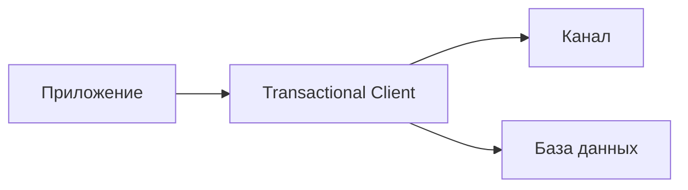

**Преимущества**: Гарантия доставки, согласованность с локальными транзакциями.

**Пример**: Отправка сообщения и сохранение в БД в одной транзакции (Outbox Pattern).

---

### **5. System Management (Управление системой)**

#### **5.1. Wire Tap**
**Описание**: Копирует сообщения из основного канала в дополнительный для мониторинга или отладки, не влияя на основной поток .

```mermaid
graph LR
    A[Основной канал] --> B[Основной поток]
    A --> C[Wire Tap]
    C --> D[Мониторинг/Аудит]
```

**Преимущества**: Наблюдаемость без влияния на производительность.

**Пример**: Копирование всех сообщений в систему аудита.

---

#### **5.2. Message History**
**Описание**: Добавляет в сообщение информацию о том, через какие компоненты оно прошло .

```mermaid
graph LR
    A[Сообщение] --> B[Компонент 1]
    B --> C[Компонент 2]
    C --> D[Компонент 3]
    D --> E[Сообщение + History]
```

**Преимущества**: Отслеживание пути сообщения, упрощение отладки.

**Пример**: Запись всех шагов обработки заказа для аудита.

---

#### **5.3. Control Bus**
**Описание**: Использует каналы обмена сообщениями для управления и мониторинга самой системы интеграции .

```mermaid
graph LR
    A[Control Bus] --> B[Мониторинг]
    A --> C[Управление]
    A --> D[Конфигурация]
```

**Преимущества**: Единый подход к управлению распределённой системой.

**Пример**: Отправка команды на перезапуск определённого компонента через message bus.

---

## **Пример реализации на C# (Apache Camel / MassTransit)**

```csharp
// Пример использования MassTransit для реализации Content-Based Router
public class OrderConsumer : IConsumer<OrderCreated>
{
    private readonly IBus _bus;

    public async Task Consume(ConsumeContext<OrderCreated> context)
    {
        // Content-Based Router: маршрутизация по типу товара
        var order = context.Message;
        
        if (order.ProductType == "Book")
        {
            await _bus.Publish(new BookOrderCreated(order.Id));
        }
        else if (order.ProductType == "Electronics")
        {
            await _bus.Publish(new ElectronicsOrderCreated(order.Id));
        }
        else
        {
            await _bus.Publish(new OtherOrderCreated(order.Id));
        }
    }
}
```

---

### **1. Content-Based Router (MassTransit)**

```csharp
// Определение сообщений
public record OrderCreated(int OrderId, string ProductType, decimal Amount);
public record BookOrderCreated(int OrderId);
public record ElectronicsOrderCreated(int OrderId);

// Роутер через middleware
public class OrderRouter : IConsumer<OrderCreated>
{
    private readonly IPublishEndpoint _publishEndpoint;

    public OrderRouter(IPublishEndpoint publishEndpoint)
    {
        _publishEndpoint = publishEndpoint;
    }

    public async Task Consume(ConsumeContext<OrderCreated> context)
    {
        var order = context.Message;

        // Content-Based Router
        var targetMessage = order.ProductType switch
        {
            "Book" => (object)new BookOrderCreated(order.OrderId),
            "Electronics" => new ElectronicsOrderCreated(order.OrderId),
            _ => throw new NotSupportedException($"Unknown product type: {order.ProductType}")
        };

        await _publishEndpoint.Publish(targetMessage);
    }
}
```

---

### **2. Splitter и Aggregator**

```csharp
// Splitter: разбивает заказ на позиции
public class OrderSplitter : IConsumer<OrderCreatedWithItems>
{
    private readonly ISendEndpointProvider _sendEndpointProvider;

    public async Task Consume(ConsumeContext<OrderCreatedWithItems> context)
    {
        var order = context.Message;
        var endpoint = await _sendEndpointProvider.GetSendEndpoint(
            new Uri("queue:process-single-item"));

        foreach (var item in order.Items)
        {
            await endpoint.Send(new ProcessOrderItem(order.OrderId, item));
        }
    }
}

// Aggregator: собирает результаты обработки позиций
public class OrderAggregator : IConsumer<OrderItemProcessed>
{
    private static readonly ConcurrentDictionary<int, List<OrderItemProcessed>> _pendingOrders = new();

    public async Task Consume(ConsumeContext<OrderItemProcessed> context)
    {
        var processed = context.Message;
        var items = _pendingOrders.GetOrAdd(processed.OrderId, _ => new List<OrderItemProcessed>());
        
        lock (items)
        {
            items.Add(processed);
            
            // Проверяем, все ли позиции обработаны
            if (items.Count == processed.TotalItems)
            {
                _pendingOrders.TryRemove(processed.OrderId, out _);
                // Публикуем агрегированный результат
                await context.Publish(new OrderCompleted(processed.OrderId));
            }
        }
    }
}
```

---

### **3. Message Filter**

```csharp
// Message Filter через middleware MassTransit
public class OrderFilter : IFilter<ConsumeContext<OrderCreated>>
{
    public async Task Send(ConsumeContext<OrderCreated> context, IPipe<ConsumeContext<OrderCreated>> next)
    {
        // Пропускаем только заказы с суммой > 10000
        if (context.Message.Amount > 10000)
        {
            await next.Send(context);
        }
        // Иначе сообщение отбрасывается
    }

    public void Probe(ProbeContext context) { }
}

// Регистрация фильтра
cfg.UseFilter(new OrderFilter());
```

---

## **Сравнение подходов**

| Шаблон | Согласованность | Сложность | Подходит для |
|--------|-----------------|-----------|--------------|
| **Message Router** | N/A | Низкая | Маршрутизация запросов |
| **Splitter + Aggregator** | Eventual | Высокая | Составные операции |
| **Content Enricher** | N/A | Средняя | Обогащение данных |
| **Claim Check** | N/A | Средняя | Большие сообщения |
| **Wire Tap** | N/A | Низкая | Мониторинг |
| **Scatter-Gather** | Eventual | Высокая | Параллельный опрос |

---

## **Рекомендации по выбору**

- **Для простой маршрутизации**: Content-Based Router, Message Filter.
- **Для составных операций**: Splitter + Aggregator, Scatter-Gather.
- **Для трансформации данных**: Message Translator, Content Enricher, Normalizer.
- **Для мониторинга**: Wire Tap, Message History.
- **Для управления системой**: Control Bus.

---

## **Когда использовать интеграционные шаблоны?**

- Для **интеграции разнородных систем** с разными протоколами и форматами данных.
- Когда требуется **слабая связанность** между компонентами.
- Для **асинхронной обработки**, устойчивой к сбоям.
- Если система **масштабируется** и добавляются новые сервисы.
- Когда важна **наблюдаемость** и возможность отладки распределённых потоков.