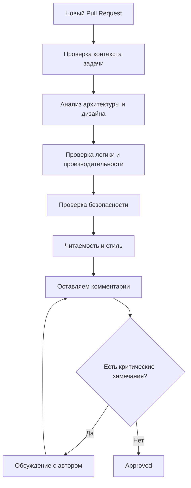

## Mermaid-диаграмма: Процесс ревью кода


## Оглавление
- [Mermaid-диаграмма: Процесс ревью кода](#mermaid-диаграмма-процесс-ревью-кода)
  - [**📋 Чек-лист ревью кода (C# / ASP.NET Core / IoT)**](#чек-лист-ревью-кода-c-aspnet-core-iot)
    - [**1. Архитектура и дизайн**](#1-архитектура-и-дизайн)
    - [**2. Читаемость и поддерживаемость**](#2-читаемость-и-поддерживаемость)
    - [**3. Производительность**](#3-производительность)
    - [**4. Тестируемость**](#4-тестируемость)
    - [**5. Безопасность**](#5-безопасность)
    - [**6. Обратная связь**](#6-обратная-связь)
  - [**📌 Пример комментария в PR**](#пример-комментария-в-pr)



---

### **📋 Чек-лист ревью кода (C# / ASP.NET Core / IoT)**

#### **1. Архитектура и дизайн**
- [ ] **SOLID-принципы**:
  - Single Responsibility Principle (SRP) — метод/класс делает одно.
  - Open/Closed Principle (OCP) — код расширяем без модификации.
  - Dependency Inversion Principle (DIP) — зависимости через интерфейсы.
- [ ] **Паттерны проектирования**:
  - Уместно ли использованы Repository, Unit of Work, Factory, Strategy?
  - Нет ли избыточных паттернов (например, Repository поверх EF Core без причины).
- [ ] **Разделение слоёв**:
  - Логика не в контроллерах/представлениях.
  - Контроллеры тонкие, бизнес-логика в сервисах.

#### **2. Читаемость и поддерживаемость**
- [ ] **Именование**:
  - Методы/классы названы ясно (например, `CalculateTotalPrice` вместо `Calc`).
  - Переменные отражают смысл (например, `userOrder` вместо `data`).
- [ ] **Комментарии**:
  - Объясняют "почему", а не "что".
  - Нет избыточных комментариев (код самодокументируемый).
- [ ] **Форматирование**:
  - Единообразие в отступах, фигурных скобках.
  - Используется **EditorConfig**.

#### **3. Производительность**
- [ ] **N+1 проблема**:
  - Нет лишних запросов к БД (используется `Include` или `Select`).
- [ ] **LINQ и EF Core**:
  - Используется `AsNoTracking()` для операций только на чтение.
  - Нет лишних `ToList()`/`ToArray()` в цепочках.
- [ ] **Кэширование**:
  - Можно ли кэшировать часто запрашиваемые данные (`IMemoryCache`)?

#### **4. Тестируемость**
- [ ] **Юнит-тесты**:
  - Есть тесты для критических частей кода.
  - Зависимости легко замокать (интерфейсы + DI).
- [ ] **Интеграционные тесты**:
  - Покрыты сценарии взаимодействия с БД/внешними сервисами.

#### **5. Безопасность**
- [ ] **Валидация входных данных**:
  - Проверка на `null`, корректность форматов (email, даты).
  - Используются атрибуты (`[Required]`, `[EmailAddress]`).
- [ ] **Защита от инъекций**:
  - Нет конкатенации строк в SQL-запросах (параметризованные запросы или ORM).
- [ ] **Логирование**:
  - Не логируются пароли, токены, личная информация.

#### **6. Обратная связь**
- [ ] **Конструктивность**:
  - Комментарии в стиле: *"Давай обсудим, как можно улучшить этот участок. Что думаешь о таком подходе: ..."*.
- [ ] **Приоритизация**:
  - Разделены блокирующие (`must fix`) и рекомендательные (`nice to have`) замечания.

---

### **📌 Пример комментария в PR**
```markdown
🔹 **Архитектура**:
- [ ] Метод `ProcessOrder` нарушает SRP: обрабатывает заказ и отправляет email. Предлагаю разделить на два метода.

🔹 **Производительность**:
- [ ] Здесь может быть N+1 проблема. Лучше использовать `Include(o => o.Customer)`.

🔹 **Безопасность**:
- [ ] В методе `GetUserData` логируется токен доступа. Нужно убрать из логов.
```
